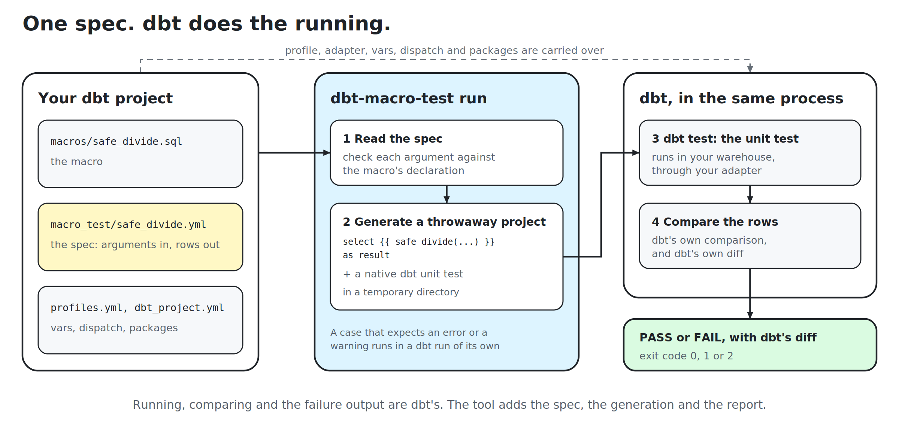

# dbt-macro-test

**Test your dbt macros.**

[](https://github.com/HirofumiTsuda/dbt-macro-test/actions/workflows/ci.yml)
[](https://github.com/HirofumiTsuda/dbt-macro-test/actions/workflows/codeql.yml)
[](https://github.com/HirofumiTsuda/dbt-macro-test/actions/workflows/security.yml)
[](https://pypi.org/project/dbt-macro-test/)
[](https://github.com/HirofumiTsuda/dbt-macro-test/blob/main/LICENSE)


Call a macro with the arguments you choose, say what it should return, and run it on your machine
or in CI. A test is a few lines of YAML; the tool turns each case into one of dbt's own unit tests,
so the result, and the diff when it fails, are dbt's.

**Documentation: <https://hirofumitsuda.github.io/dbt-macro-test/>**: a guide of what to write for
the macro you have, and every key of a spec.


- **A macro can be tested like a function.** Arguments in, rows out. dbt's native unit tests cover
  models only ([dbt-labs/dbt#10547](https://github.com/dbt-labs/dbt/issues/10547)), so there was
  no way to call a macro with given inputs and assert on what it gives.
- **dbt does the running.** Your project's profile, adapter, `vars`, `dispatch` and packages are
  used; the comparison and the output of a failure are dbt's own, not a second implementation.
- **More than rows.** The expected rows written out, as csv or SQL, or in a file; the error or the
  warning that a macro raises; `overrides` of macros, `vars` and environment variables for a case.
- **Made for CI.** Exit code 0, 1 or 2, `--select`, Linux and Windows, dbt-core 1.8 and later, and
  an example for GitHub Actions below.

**Status: alpha.** The interface may still change. It has been run on duckdb and on Postgres (the
sample project and the project of the tests, in CI) and on no other adapter (see
[What is not supported](https://github.com/HirofumiTsuda/dbt-macro-test#what-is-not-supported)).

This project is independent and is not affiliated with or endorsed by dbt Labs. "dbt" is a
trademark of dbt Labs, Inc.

## Quick start

<!-- --8<-- [start:quickstart] -->
**1. Install.** The tool runs dbt **in the same process**, so the adapter of your project has to be
installed in the same environment, with dbt-core (1.8 or later; the tool brings it):

```bash
pip install dbt-duckdb        # or dbt-snowflake, dbt-bigquery, ... the one your project uses
pip install dbt-macro-test
```

Python 3.11 or later; Linux and Windows are run in CI, macOS has not been.

**2. Write a test.** In a dbt project, with a macro:

```sql
-- macros/safe_divide.sql

    {{ numerator }} / nullif({{ denominator }}, 0)

```

and write a spec for it under `macro_test/`:

```yaml
# macro_test/safe_divide.yml
macros:
  - macro: safe_divide
    cases:
      - name: plain_division
        given:
          arguments: {numerator: 10, denominator: 4}
        expect:
          rows:
            - {result: 2.5}      # a macro's output is the `result` column
      - name: division_by_zero_is_null
        given:
          arguments: {numerator: 10, denominator: 0}
        expect:
          rows:
            - {result: null}
```

**3. Run it**, from the project:

```console
$ dbt-macro-test run
1 of 2 PASS _dmt_safe_divide_safe_divide_division_by_zero_is_null::division_by_zero_is_null  [PASS in 0.08s]
2 of 2 PASS _dmt_safe_divide_safe_divide_plain_division::plain_division ........ [PASS in 0.02s]
Done. PASS=2 WARN=0 ERROR=0 SKIP=0 NO-OP=0 REUSED=0 TOTAL=2

2 passed
```

When a case fails, dbt's own diff is shown, and the exit code is 1 (here the spec expected `2.0`):

```console
[ERROR]: in unit_test plain_division (models/_unit_tests.yml)

actual differs from expected:

@@ ,result
+++,Decimal('2.5')
---,Decimal('2.0')

1 failed, 1 passed
```

Both outputs are trimmed (dbt's start-up lines and the timestamps are left out). They are from
running exactly this, in a new project with a duckdb profile and the tool installed as above.

The expected values are those of duckdb. On Postgres, `10 / 4` divides two integers as integers and
gives `2`, so the first case there would fail; a case can be limited to some adapters with
`adapters` (see the [guide](https://hirofumitsuda.github.io/dbt-macro-test/guide/#a-case-for-one-database)).
<!-- --8<-- [end:quickstart] -->

**Next:** [what to write for your macro](#what-to-write-for-your-macro): an error, a warning, text, a `ref`, a macro that writes.

## What to write for your macro

Find the kind of macro you have, and copy the example from the
[guide](https://github.com/HirofumiTsuda/dbt-macro-test/blob/main/docs/guide.md); every example
there runs in CI.

| Your macro... | Write |
|---|---|
| gives a value (a SQL expression) | the default, as above |
| gives several columns, or a whole `select` | `output: columns`, `output: query` |
| gives text that is not SQL (a code, a slug) | `output: text` |
| stops with an error, or warns | `expect.error`, `expect.warning` |
| reads a `var`, an environment variable, or calls another macro | `overrides` |
| is a macro of a package (`dbt_utils.slugify`) | `macro: package.macro` |
| reads a model or a source | `given.inputs`: the rows it is to see |
| writes (insert, merge, delete) | `setup.relations` and `expect.query` (this one writes: read [the warning](https://github.com/HirofumiTsuda/dbt-macro-test/blob/main/docs/spec.md#a-macro-that-writes)) |
| returns the text of a statement | `run: execute` |

[`dev/sample_project`](https://github.com/HirofumiTsuda/dbt-macro-test/tree/main/dev/sample_project)
is a small dbt project with a spec for each of these, one to read and to try a change on. Every key
is in the [spec reference](https://github.com/HirofumiTsuda/dbt-macro-test/blob/main/docs/spec.md).

## Why this exists

Although dbt macros are useful, it is not straightforward to test them. dbt's own unit tests are for
models, so this is what people do today, and where each puts its tests:

| Approach | How | Where the tests live |
|---|---|---|
| A model that calls the macro, with a native unit test of it, by hand ([a write-up](https://www.dumky.net/posts/unit-testing-dbt-macros-a-workaround-for-dbts-unit-testing-limitations/), March 2025) | the macro's output is the model's, and dbt compares it | your project's `models/`, so in its manifest, next to the real models |
| [`dbt-unittest`](https://github.com/yu-iskw/dbt-unittest) | assertion macros (`assert_equals`, ...), run with `dbt run-operation` | your project's `macros/` |
| A dedicated testing project, as dbt packages do (`dbt-utils` has an [`integration_tests`](https://github.com/dbt-labs/dbt-utils/tree/main/integration_tests) project; see [the dbt blog](https://docs.getdbt.com/blog/unit-testing-dbt-packages)) | seeds, models and tests of its own | a second project, written and kept by hand |
| [`pytest-dbt-core`](https://github.com/godatadriven/pytest-dbt-core) | a pytest plugin; its docs test a macro through a fixture | Python files |
| [`dbt-unit-testing`](https://github.com/EqualExperts/dbt-unit-testing) | tests models, not macros; it said in January 2024 that it had no plans to support macros | |

Native support has been asked for in
[dbt-labs/dbt#10547](https://github.com/dbt-labs/dbt/issues/10547) since August 2024; as of November
2026 it is still open (10 comments, 21 👍). The request itself describes the first approach as
cumbersome, since the test models would sit in `models/` where they "could conflict with real models
and make discoverability harder", and says a dedicated testing project "would introduce a lot of
overhead".

This tool is that dedicated testing project, generated: from one YAML spec under `macro_test/` it
writes the wrapper models and the unit tests into a temporary project and has dbt run them. Nothing
is added to your project or to its manifest (after a run, the files of the project are the same, byte
for byte, apart from the `.user.yml` that dbt itself writes), and a CI job needs one command and its
exit codes.

## How it works



Each case of a spec becomes a throwaway model that calls the macro, and a native dbt unit test of
that model, in a temporary directory; dbt runs them. Execution, comparison and the output of a
failure are dbt's own. What the tool adds is the spec format, the generation of the project, a
check of the arguments before dbt runs, and the report. If dbt ships a way to test macros of its
own, the specs still say what a macro should do, which is the part worth keeping.
[`docs/design.md`](https://github.com/HirofumiTsuda/dbt-macro-test/blob/main/docs/design.md) says
how it works and why;
[`docs/history/design-log.md`](https://github.com/HirofumiTsuda/dbt-macro-test/blob/main/docs/history/design-log.md)
has the evidence for the gap and the prior art.

## The command line

```bash
dbt-macro-test run                              # everything under ./macro_test
dbt-macro-test run macro_test/safe_divide.yml   # one file, or a directory
dbt-macro-test run --target ci                  # a target of the profile
dbt-macro-test run --project-dir ../shop        # from anywhere
dbt-macro-test run --select safe_divide         # every case of one macro
dbt-macro-test run --select "safe_*::by_zero"   # macro::case; * and ? stand for any characters
dbt-macro-test run --list --select greeting     # show what would run, run nothing
```

| Option | |
|---|---|
| `PATH` | A spec file or a directory. Default: `macro_test/` of the project. |
| `--project-dir` | The dbt project. Default: the nearest directory at or above `PATH` (or the working directory) with a `dbt_project.yml`. |
| `--profiles-dir` | Where `profiles.yml` is. Default: `$DBT_PROFILES_DIR`, then the project's own `profiles.yml`, then `~/.dbt` (the order dbt uses). |
| `--target` | The target of the profile. |
| `--select` | Run only the cases that match; can be given more than once, the patterns are ORed. |
| `--list` | Print the cases that would run, as `macro::case`, and stop. |
| `--keep-generated` | Keep the generated dbt project (a temporary directory) and print where it is. |
| `--verbose` | Say what is carried over from the project, and which `profiles.yml` was used. |

The exit code is **0** when every case passed, **1** when a case failed or errored, and **2** when
the tests could not be run at all: an invalid spec, a wrong argument, no dbt project, dbt itself
failing, or nothing matching `--select`. The last line says what happened, such as
`1 failed, 8 passed`.

## What is carried over from the project

The project's `vars`, `dispatch` and `macro-paths` are carried over, so a macro sees what it
sees in the real project, and its packages (`packages.yml`) are available to it. Its
`on-run-start` and `on-run-end` hooks are not run. If a case cannot be run at all (a SQL error,
for instance), the SQL generated for it is printed after dbt's own output.

Packages that are already installed (in `dbt_packages/`, or where `packages-install-path`
says) are used as they are and `dbt deps` is not run, so nothing in them is changed. Otherwise
`packages.yml` is copied (a relative `local:` path made absolute) and `dbt deps` runs in the
temporary directory.

## Using it in CI

The tool needs what `dbt test` needs: the adapter installed, a `profiles.yml`, and a connection
to the warehouse in it. **Unit tests run against the warehouse**: dbt's unit-test
materialization creates a temporary relation for each case, to read the types of the columns, and
drops it (`unit.sql` in dbt-core's global project, which an adapter may override; dbt-duckdb does
not). What exactly is sent is the adapter's `create_table_as`, and only duckdb's has been seen
(`create temporary table`, in dbt's log), so plan for the credentials to need the rights of a
`dbt run` on a schema you can write to.

```yaml
# .github/workflows/macro-test.yml
name: macro tests
on: [pull_request]

jobs:
  macro-test:
    runs-on: ubuntu-latest
    steps:
      - uses: actions/checkout@v4
      - uses: actions/setup-python@v5
        with:
          python-version: "3.12"
      - run: pip install dbt-duckdb dbt-macro-test
      - run: dbt deps            # leave this out if the project has no packages.yml
      - run: dbt-macro-test run
        env:
          DBT_PROFILES_DIR: ci   # the directory of a profiles.yml that CI can use
```

- **`profiles.yml`**: give it with `--profiles-dir` or `DBT_PROFILES_DIR`. Keep the credentials
  out of it and read them from the environment with `{{ env_var('SNOWFLAKE_PASSWORD') }}`, and
  set them from the secrets of the repository.
- **Secrets are not available to pull requests from forks**, so a job that needs the warehouse
  does not work for them. Two ways round it: run the macro tests only for branches of the
  repository (`on: push`, or `if: github.event.pull_request.head.repo.full_name ==
  github.repository` on the job), or use a local adapter for CI, as follows.
- **A local adapter, such as duckdb, as the CI target** needs no credentials and no warehouse
  (add a `ci` target of type `duckdb` to `profiles.yml`, and `--target ci`). The price: dbt picks
  the implementation of a macro by the type of the adapter (`adapter.dispatch`), so a run on duckdb
  tests the `duckdb__` or `default__` implementation, not the one for your warehouse, and SQL
  that only your warehouse understands will not run on it. It is a good fit for macros that
  are plain SQL or Jinja, and not for what is warehouse-specific.
- **`dbt deps`**: it needs the network (the hub, or git), and it is the slowest step of a typical
  job; cache `dbt_packages/` on a hash of `packages.yml` (or `package-lock.yml`) if it matters.
  When `dbt_packages/` is there, the tool uses it as it is and does not run `dbt deps`. dbt
  checks only that the *number* of installed packages matches `packages.yml`, so a package whose
  *version* was changed is not noticed: run `dbt deps` before `dbt-macro-test run`, as the example
  does.

## What is not supported

Each of these has an issue.

- Asserting on a macro's return value without a database
  ([#11](https://github.com/HirofumiTsuda/dbt-macro-test/issues/11)).
- The setup of a case from a csv or a file; any macro that writes, on an adapter other than duckdb
  ([#30](https://github.com/HirofumiTsuda/dbt-macro-test/issues/30)).
- A `ref` of a model of a package, `ref('package', 'model')`, as an input
  ([#9](https://github.com/HirofumiTsuda/dbt-macro-test/issues/9)).
- Generic tests ([#13](https://github.com/HirofumiTsuda/dbt-macro-test/issues/13)), and asserting on
  which macros were called ([#16](https://github.com/HirofumiTsuda/dbt-macro-test/issues/16)).
- dbt Fusion ([#23](https://github.com/HirofumiTsuda/dbt-macro-test/issues/23)); the tool runs
  dbt-core in-process.
- Adapters other than duckdb and Postgres: the tool leaves the work to dbt, so others may well work,
  but none has been run ([#14](https://github.com/HirofumiTsuda/dbt-macro-test/issues/14)).

The tool runs dbt through `dbtRunner`, dbt's programmatic entry point. It also uses three
things that are not a documented interface: the project file, read with
`dbt.config.project.load_raw_project`; the function of `dbt_common` that finds the macros in a
file; and the fields of the results and events of a run. A new dbt-core may change them; the suite
is run on dbt-core 1.8 and on the newest one in CI to find where they differ. See
[`docs/design.md`](https://github.com/HirofumiTsuda/dbt-macro-test/blob/main/docs/design.md).

## Development

Needs [uv](https://docs.astral.sh/uv/).

```bash
uv sync
uv run pytest
```

The tests run on up to four workers (`pytest-xdist`, set in `pyproject.toml`), and the
end-to-end ones, which run dbt, take most of the time. To run one test, or to see a
failure without the workers, use `uv run pytest -n 0 path/to/test.py::test_name`. CI runs the
suite on Python 3.11 to 3.14, on dbt-core 1.8, and on Windows; dbt-core 1.9, 1.10 and 1.11 were
each run once by hand.

The documentation site is [Starlight](https://starlight.astro.build/) in `website/`, over the
Markdown of `docs/`, the README and the changelog, which stay plain Markdown that reads on GitHub:
`website/prepare.py` writes the pages from them before each build. It is the one part that needs
Node (22.23.4 or later; `website/.node-version`); the rest does not. To see it while you edit,
`cd website && npm ci && npm run dev`. CI builds it (`npm run build`), where a broken link or a
heading that is not there fails, and publishes it when `main` changes.

Two more workflows look for security problems. **CodeQL** analyses the Python code and the
workflows, on pull requests, on pushes to `main` and every Monday; its findings are under Security,
Code scanning. **Security** checks the dependencies for known vulnerabilities, those in `uv.lock`
with `pip-audit` (pinned in the `security` group) and those of the site with `npm audit`, when a lock
file changes and every Monday, since an advisory can appear without any change here. A failure of
the second means a package is to be updated (`uv lock --upgrade-package <name>`). Neither is a
required check of `main`; the badges at the top of this page show their last run.

The dependencies in `uv.lock` and the pinned actions of the workflows are kept up to date by
Dependabot (`.github/dependabot.yml`): once a week, one pull request each for the actions, the
Python dependencies and the site's, which run CI and are merged like any other.

## License

[MIT](https://github.com/HirofumiTsuda/dbt-macro-test/blob/main/LICENSE)
